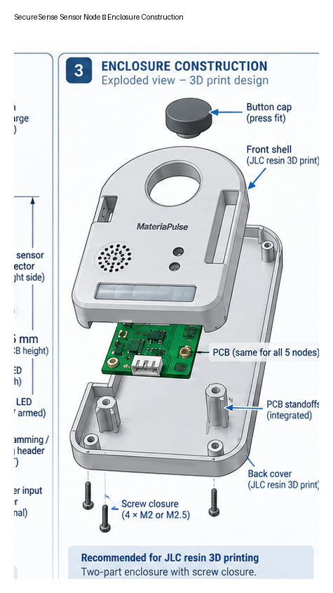
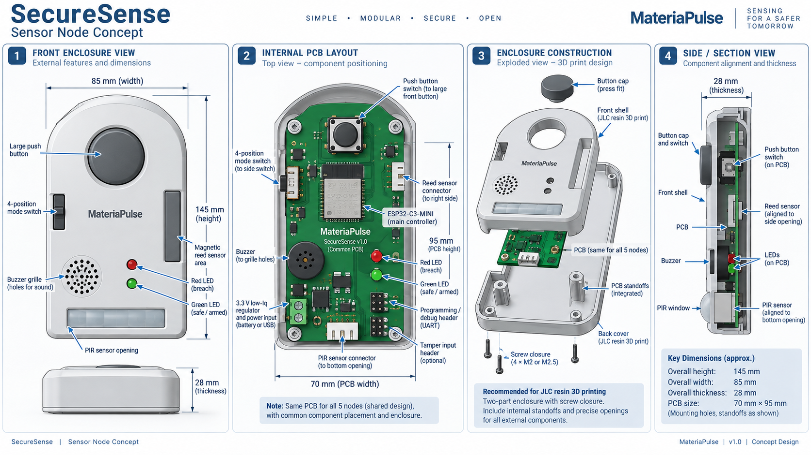
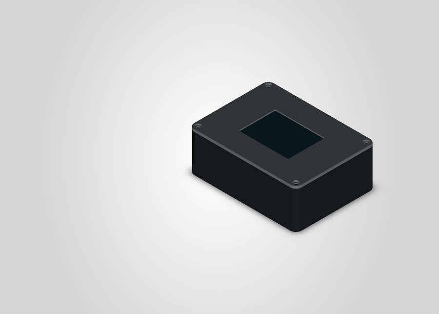
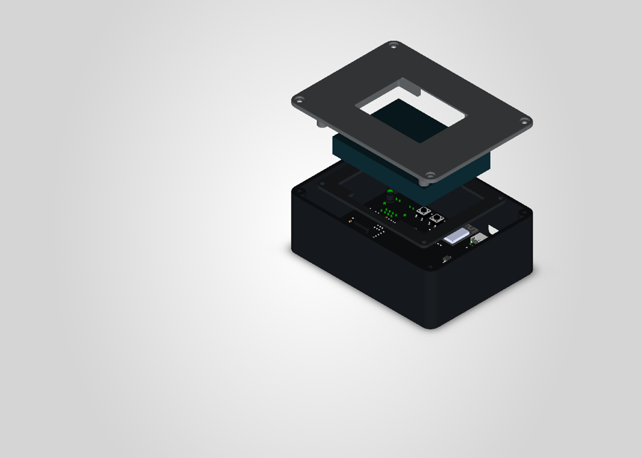
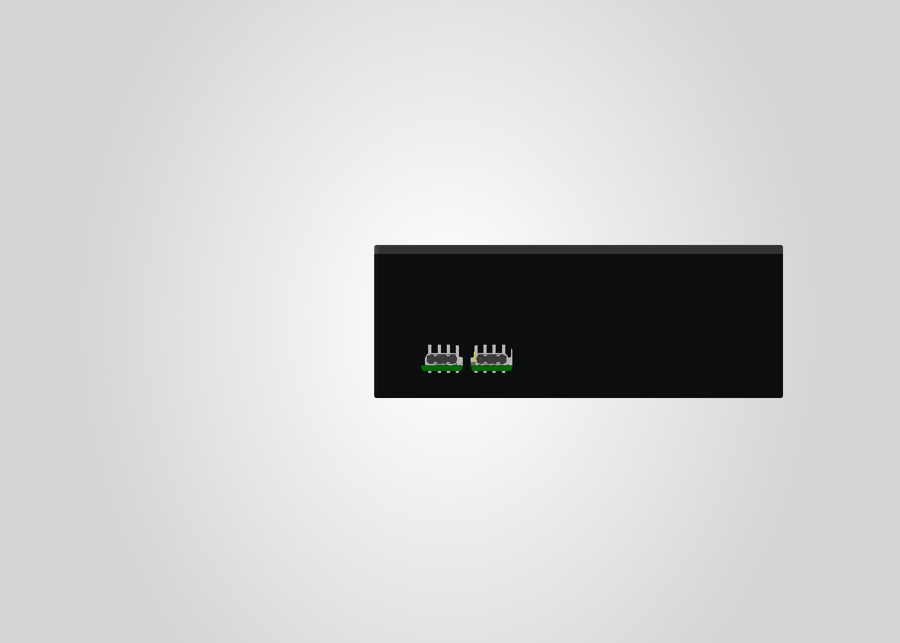

# SecureSense

**SecureSense** is an IoT-based security/alarm prototype built around an ESP32-C3 sensor node, an ESP32-S3 main hub, ESP-NOW communication, Wi-Fi, MQTT/TLS, a Node.js backend, and a React web dashboard.

This README is written as a **setup and reproduction guide**. A new person should be able to clone the repository, build the same hardware, replace the project owner's Wi-Fi/MQTT settings with their own, and run the system without having to guess which files contain the configuration.

> **Prototype notice:** SecureSense is a university/lab prototype. The current ESP-NOW pairing/command path is not authenticated or encrypted, and the system should not be treated as a production-grade security product without further security hardening and validation.

---

## 1. System architecture

```text
Reed / PIR sensors
        |
        v
+-----------------------+
| ESP32-C3 Sensor Node  |
| Local alarm logic     |
+-----------------------+
        |
        | ESP-NOW
        v
+-----------------------+
| ESP32-S3 Main Hub     |
| Wi-Fi + MQTT/TLS      |
+-----------------------+
        |
        | MQTT over TLS
        v
+-----------------------+
| MQTT Broker           |
| e.g. EMQX Cloud       |
+-----------------------+
        |
        v
+-----------------------+
| Node.js / Fastify     |
| MQTT bridge + SQLite  |
+-----------------------+
        |
        | WebSocket
        v
+-----------------------+
| React Web Dashboard   |
+-----------------------+
```

### Important

The **ESP32-C3 does not connect directly to Wi-Fi or MQTT**.

The **ESP32-S3 is the device that connects to the local 2.4 GHz Wi-Fi network and the MQTT broker**.

The web backend is another MQTT client and therefore has its own MQTT credentials.

---

# 2. Enclosure designs

The repository can also be accompanied by the project's enclosure visuals. The images included with this README package are placed under:

```text
docs/images/
```

## SecureSense sensor node enclosure

The sensor-node concept shows the enclosure, PCB arrangement, external controls, sensor openings, and the proposed two-part enclosure construction.



A larger concept sheet is also included:



## SecureSense main hub enclosure

The following renders show the main ESP32-S3 hub enclosure.



### Exploded view



### Top view


### USB / rear-side view



---

# 3. Repository structure

```text
SecureSense/
│
├── 02_C3_SecureSense_Node/
│   ├── 02_C3_SecureSense_Node.ino
│   └── SecureSenseProtocol.h
│
├── 03_S3_SecureSense_Hub/
│   ├── 03_S3_SecureSense_Hub.ino
│   ├── SecureSenseProtocol.h
│   └── secrets.example.h
│
├── webapp/
│   ├── .env.example
│   ├── README.md
│   ├── package.json
│   ├── package-lock.json
│   ├── server/
│   ├── web/
│   └── tools/
│
├── start-securesense-local.cmd
├── render.yaml
├── .gitignore
└── README.md
```

### Important configuration files

| File | Purpose |
|---|---|
| `03_S3_SecureSense_Hub/secrets.example.h` | Public template for S3 Wi-Fi/MQTT configuration |
| `03_S3_SecureSense_Hub/secrets.h` | Private S3 configuration created locally |
| `webapp/.env.example` | Public backend configuration template |
| `webapp/.env` | Private backend configuration created locally |
| `02_C3_SecureSense_Node/SecureSenseProtocol.h` | C3 communication protocol |
| `03_S3_SecureSense_Hub/SecureSenseProtocol.h` | S3 communication protocol |
| `start-securesense-local.cmd` | Windows helper for starting the web application |

---

# 4. What must be changed for another person's setup?

A new user normally changes the following.

### ESP32-S3

```cpp
WIFI_SSID
WIFI_PASSWORD

MQTT_URI
MQTT_USERNAME
MQTT_PASSWORD
MQTT_TOPIC_PREFIX
MQTT_CA_CERT
```

### ESP32-C3

Normally **nothing related to Wi-Fi or MQTT needs to be changed**.

The C3 communicates with the S3 using ESP-NOW.

### Web backend

```text
MQTT_URL
MQTT_USERNAME
MQTT_PASSWORD
MQTT_TOPIC_PREFIX
NODE_ID
```

The web dashboard login is separate from the MQTT credentials.

---

# 5. Hardware

The current firmware is intended for an ESP32-C3 sensor node and ESP32-S3 hub.

Typical sensor-node hardware includes:

- ESP32-C3
- Reed switch
- HC-SR501 PIR sensor
- Green status LED
- Red alarm LED
- Buzzer
- Local silence button
- Sensor-selection switches
- Power supply/battery circuitry as implemented by the project hardware

The hub uses an ESP32-S3 and provides the Wi-Fi/MQTT gateway between the sensor node and the backend.

---

# 6. ESP32-C3 sensor node

Open:

```text
02_C3_SecureSense_Node/02_C3_SecureSense_Node.ino
```

The C3 handles the local sensing and alarm behaviour.

The current firmware uses:

| GPIO | Function |
|---|---|
| GPIO0 | Reed switch |
| GPIO3 | PIR sensor |
| GPIO2 | Green LED |
| GPIO8 | Red LED |
| GPIO9 | Local silence button |
| GPIO10 | Buzzer drive |
| GPIO6 | Reed-enable DIP |
| GPIO7 | PIR-enable DIP |

The exact hardware wiring must match the firmware.

### Important

Do **not** put the Wi-Fi SSID/password or MQTT credentials into the C3 firmware.

The C3 talks to the S3 over ESP-NOW.

---

# 7. ESP32-S3 main hub

Open:

```text
03_S3_SecureSense_Hub/03_S3_SecureSense_Hub.ino
```

The S3:

1. Connects to the 2.4 GHz Wi-Fi network.
2. Discovers the C3 using ESP-NOW.
3. Receives sensor/status packets.
4. Sends commands to the C3.
5. Connects to the MQTT broker.
6. Publishes hub/node information through MQTT.
7. Receives remote commands from the backend.

---

# 8. Create the private S3 configuration

Do not put real credentials into `secrets.example.h`.

Copy:

```text
03_S3_SecureSense_Hub/secrets.example.h
```

to:

```text
03_S3_SecureSense_Hub/secrets.h
```

Then edit `secrets.h`.

The repository `.gitignore` already excludes `secrets.h`.

---

# 9. Configure Wi-Fi

In `secrets.h`:

```cpp
constexpr const char* WIFI_SSID     = "YOUR_2_4_GHZ_WIFI";
constexpr const char* WIFI_PASSWORD = "YOUR_WIFI_PASSWORD";
```

Replace these with the Wi-Fi credentials of the network where the system will be used.

Example:

```cpp
constexpr const char* WIFI_SSID     = "MyHomeWiFi";
constexpr const char* WIFI_PASSWORD = "MyHomePassword";
```

### Important

The S3 firmware expects a **2.4 GHz Wi-Fi network**.

Do not commit real Wi-Fi credentials to GitHub.

---

# 10. MQTT / EMQX setup

The project uses MQTT to connect the S3 hub and the web backend.

A new user should create/use their own MQTT broker account/deployment rather than relying on another person's credentials.

The current project documentation is written around an MQTT/TLS broker such as **EMQX Cloud**.

For an EMQX Cloud deployment, obtain:

```text
Broker hostname
MQTT TLS port
MQTT username
MQTT password
CA certificate
```

The TLS MQTT connection normally uses port:

```text
8883
```

---

# 11. Create separate MQTT users

It is better to use separate credentials for the hardware hub and web backend.

For example:

```text
S3:
username = securesense-s3
password = YOUR_S3_MQTT_PASSWORD

Web backend:
username = securesense-web
password = YOUR_WEB_MQTT_PASSWORD
```

Do not use the same MQTT credentials for every client.

This makes the system easier to manage and allows broker ACLs to restrict what each client can publish/subscribe to.

---

# 12. Configure the S3 MQTT connection

In:

```text
03_S3_SecureSense_Hub/secrets.h
```

configure:

```cpp
constexpr const char* MQTT_URI =
    "mqtts://YOUR_EMQX_BROKER:8883";

constexpr const char* MQTT_USERNAME =
    "securesense-s3";

constexpr const char* MQTT_PASSWORD =
    "YOUR_S3_MQTT_PASSWORD";

constexpr const char* MQTT_TOPIC_PREFIX =
    "securesense/hub1";
```

Replace the broker hostname with the hostname belonging to your MQTT deployment.

---

# 13. MQTT CA certificate

For:

```text
mqtts://
```

the S3 firmware requires the broker CA certificate.

In `secrets.h`, configure:

```cpp
constexpr const char* MQTT_CA_CERT = R"PEM(
-----BEGIN CERTIFICATE-----
PASTE_THE_COMPLETE_CA_CERTIFICATE_HERE
-----END CERTIFICATE-----
)PEM";
```

Use the CA certificate provided by your MQTT broker/deployment.

Keep the complete:

```text
-----BEGIN CERTIFICATE-----
...
-----END CERTIFICATE-----
```

block.

Do not disable TLS verification as a shortcut.

---

# 14. MQTT topic prefix

The default prefix is:

```text
securesense/hub1
```

The firmware builds the MQTT topics from this prefix.

Examples:

```text
securesense/hub1/hub/online
securesense/hub1/hub/status
securesense/hub1/node/2/online
securesense/hub1/node/2/status
securesense/hub1/node/2/event
securesense/hub1/node/2/cmd
securesense/hub1/node/2/cmd_result
```

If a new user wants a separate namespace, they can use something such as:

```text
securesense/myhub
```

If the topic prefix is changed, it must be changed consistently in:

```text
S3 secrets.h
webapp/.env
```

---

# 15. MQTT ACLs

The exact ACL syntax depends on the MQTT broker.

For the current single-node setup, the intended permissions are approximately:

### S3 user

Publish:

```text
securesense/hub1/hub/#
securesense/hub1/node/2/online
securesense/hub1/node/2/status
securesense/hub1/node/2/event
securesense/hub1/node/2/cmd_result
```

Subscribe:

```text
securesense/hub1/node/2/cmd
```

### Web backend user

Publish:

```text
securesense/hub1/node/2/cmd
```

Subscribe:

```text
securesense/hub1/hub/#
securesense/hub1/node/2/online
securesense/hub1/node/2/status
securesense/hub1/node/2/event
securesense/hub1/node/2/cmd_result
```

Restrict the credentials to the topics they actually need.

---

# 16. Web application

The web application is in:

```text
webapp/
```

It contains:

- Fastify backend
- MQTT bridge
- SQLite database
- authentication
- WebSocket updates
- React frontend
- local MQTT broker
- hub simulator

The browser does not directly communicate with MQTT. The backend handles the MQTT connection.

---

# 17. Node.js requirement

The current `package.json` requires:

```text
Node.js >= 22.13
```

Node 24 was used during development.

Check:

```powershell
node --version
npm --version
```

---

# 18. Clone the repository

Use Git:

```powershell
git clone https://github.com/Abdul-Rahman-bme/SecureSense.git
cd SecureSense
```

Then:

```powershell
cd webapp
npm ci --include=dev
```

---

# 19. Configure the web backend

Copy:

```text
webapp/.env.example
```

to:

```text
webapp/.env
```

Windows PowerShell:

```powershell
Copy-Item .env.example .env
```

Linux/macOS:

```bash
cp .env.example .env
```

---

# 20. Configure web MQTT credentials

For your own MQTT deployment:

```ini
MQTT_URL=mqtts://YOUR_EMQX_BROKER:8883
MQTT_USERNAME=securesense-web
MQTT_PASSWORD=YOUR_WEB_MQTT_PASSWORD
MQTT_TOPIC_PREFIX=securesense/hub1
NODE_ID=2
```

These values must correspond to the same MQTT system used by the S3.

### Important distinction

The backend should use its **own MQTT account**.

Do not assume that the S3 username/password and web backend username/password have to be identical.

---

# 21. Web dashboard login

The web dashboard login is separate from MQTT authentication.

From the `webapp` directory:

```bash
npm run user -- add admin
```

The command prompts for the dashboard password.

Change a password:

```bash
npm run user -- passwd admin
```

List users:

```bash
npm run user -- list
```

Therefore, keep these three credential groups separate:

```text
1. Wi-Fi credentials
2. MQTT credentials
3. Dashboard login credentials
```

---

# 22. Run the web application

For development:

```bash
npm run dev
```

or use:

```bash
npm run dev:server
```

and:

```bash
npm run dev:web
```

The Vite development frontend is normally available at:

```text
http://localhost:5173
```

---

# 23. Run the final/single-port version

Build the frontend:

```bash
npm run build
```

Then:

```bash
npm start
```

The application is normally available at:

```text
http://localhost:3000
```

---

# 24. Windows startup helper

From the repository root:

```text
start-securesense-local.cmd
```

The helper:

1. Opens the webapp directory.
2. Checks for `webapp/.env`.
3. Installs dependencies if required.
4. Builds the React frontend.
5. Starts Fastify.
6. Opens the dashboard.

Make sure `webapp/.env` has already been created and configured.

---

# 25. Test the web application without hardware

The repository contains development tools.

From:

```text
webapp/
```

run:

```bash
npm run broker
```

for the local MQTT broker.

Run:

```bash
npm run sim
```

for the hub simulator.

This allows the backend and dashboard to be tested without the physical C3/S3 hardware.

The simulator supports test inputs including:

```text
d = door
m = motion
b = button
n = node online/offline
h = hub online/offline
```

This is useful for verifying the software before troubleshooting the hardware.

---

# 26. Upload the S3 firmware

Open:

```text
03_S3_SecureSense_Hub/03_S3_SecureSense_Hub.ino
```

Make sure:

```text
03_S3_SecureSense_Hub/secrets.h
```

exists beside the `.ino` file.

Select the appropriate ESP32-S3 board in Arduino IDE.

The project was developed with Espressif Arduino-ESP32 3.x.

Use a serial monitor at:

```text
115200 baud
```

Useful S3 serial commands include:

```text
help
net
who
ping
status
```

---

# 27. Upload the C3 firmware

Open:

```text
02_C3_SecureSense_Node/02_C3_SecureSense_Node.ino
```

Select the appropriate ESP32-C3 board.

Use:

```text
115200 baud
```

The C3 searches for the S3 hub using ESP-NOW.

The current Stage 8 firmware allows the C3 to scan channels when it has not yet found the hub, allowing it to follow the router channel used by the S3.

---

# 28. Keep the protocol files compatible

Both boards use:

```text
SecureSenseProtocol.h
```

There is one copy in each firmware folder.

They represent the same communication protocol.

If the packet structure, protocol version, or message format is changed, the C3 and S3 implementations must be kept compatible.

---

# 29. Recommended first-time setup order

Follow this order for a new installation.

### Step 1 — Build the hardware

Prepare:

```text
C3 sensor node
S3 main hub
sensors
LEDs
buzzer
buttons/switches
power
```

Verify the wiring against the firmware pin assignments.

### Step 2 — Configure Wi-Fi

Choose the 2.4 GHz Wi-Fi network.

Create:

```text
03_S3_SecureSense_Hub/secrets.h
```

and enter:

```text
WIFI_SSID
WIFI_PASSWORD
```

### Step 3 — Create MQTT deployment

Create/use an MQTT broker.

Obtain:

```text
broker hostname
TLS port
CA certificate
```

### Step 4 — Create MQTT credentials

Create separate accounts for:

```text
S3 hub
web backend
```

### Step 5 — Configure S3 MQTT

Enter:

```text
MQTT_URI
MQTT_USERNAME
MQTT_PASSWORD
MQTT_TOPIC_PREFIX
MQTT_CA_CERT
```

### Step 6 — Upload S3

Flash the S3 firmware and verify Wi-Fi/MQTT connection.

### Step 7 — Upload C3

Flash the C3 firmware.

Power both boards and wait for ESP-NOW discovery.

### Step 8 — Test MQTT

Use an MQTT client if desired and subscribe to:

```text
securesense/hub1/#
```

Verify that hub/node messages appear.

### Step 9 — Configure the web application

Create:

```text
webapp/.env
```

and configure the web MQTT account.

### Step 10 — Install dependencies

```bash
cd webapp
npm ci --include=dev
```

### Step 11 — Create dashboard login

```bash
npm run user -- add admin
```

### Step 12 — Start the dashboard

```bash
npm run build
npm start
```

### Step 13 — Perform an end-to-end test

Verify:

```text
C3 sensor
   ↓
ESP-NOW
   ↓
S3
   ↓
Wi-Fi
   ↓
MQTT
   ↓
Fastify backend
   ↓
WebSocket
   ↓
Browser dashboard
```

---

# 30. Configuration checklist

| Item | File/location | Change for a new installation? |
|---|---|---|
| Wi-Fi SSID | `03_S3_SecureSense_Hub/secrets.h` | Yes |
| Wi-Fi password | `03_S3_SecureSense_Hub/secrets.h` | Yes |
| MQTT broker | `secrets.h` + `webapp/.env` | Yes |
| S3 MQTT username | `secrets.h` | Yes |
| S3 MQTT password | `secrets.h` | Yes |
| Web MQTT username | `webapp/.env` | Yes |
| Web MQTT password | `webapp/.env` | Yes |
| MQTT topic prefix | `secrets.h` + `webapp/.env` | Only if changing namespace |
| MQTT CA certificate | `secrets.h` | Yes for MQTT/TLS |
| Dashboard username | SQLite via CLI | Yes |
| Dashboard password | SQLite via CLI | Yes |
| C3 Wi-Fi credentials | None | No |
| C3 MQTT credentials | None | No |
| Node ID | Firmware/backend configuration | Normally keep current value |
| GPIO mapping | C3 `.ino` | Only if hardware changes |

---

# 31. What should never be committed to GitHub?

Never commit real:

```text
Wi-Fi passwords
MQTT passwords
dashboard passwords
private keys
private certificates/keys
03_S3_SecureSense_Hub/secrets.h
webapp/.env
webapp/data/
```

The repository already ignores the main credential files.

If credentials are ever accidentally exposed publicly, **rotate/revoke them** rather than relying only on deleting the file in a later commit.

---

# 32. Troubleshooting

## S3 cannot connect to Wi-Fi

Check:

- SSID is correct.
- Password is correct.
- The network is 2.4 GHz.
- `secrets.h` is actually present beside the S3 `.ino`.
- The router permits the board to join.

Use:

```text
net
```

in the S3 serial monitor.

---

## S3 connects to Wi-Fi but MQTT does not connect

Check:

```text
MQTT_URI
MQTT_USERNAME
MQTT_PASSWORD
MQTT_CA_CERT
```

Also check:

- broker hostname
- port 8883
- broker account
- ACL permissions
- TLS certificate
- system time/NTP

---

## MQTT works in MQTTX but not on the S3

The most likely areas are:

```text
MQTT URI
username/password
CA certificate
TLS certificate verification
clock/time synchronisation
```

Do not disable TLS verification simply to make the connection work.

---

## S3 is online but C3 is not discovered

Check:

- C3 power
- C3 firmware
- S3 firmware
- compatible `SecureSenseProtocol.h`
- radio conditions
- router/Wi-Fi channel
- current Stage 8 channel-scanning firmware

Useful S3 commands:

```text
who
ping
status
net
```

---

## Dashboard says MQTT is offline

Check:

```text
webapp/.env
```

especially:

```text
MQTT_URL
MQTT_USERNAME
MQTT_PASSWORD
MQTT_TOPIC_PREFIX
NODE_ID
```

Remember that the backend uses the **web MQTT account**, not necessarily the S3 account.

---

## Dashboard login does not work

Create/reset a user:

```bash
npm run user -- add admin
```

or:

```bash
npm run user -- passwd admin
```

---

# 33. Optional Render deployment

The repository contains:

```text
render.yaml
```

Render deployment is optional.

It is not required for local operation.

If a new user deploys their own copy, they should review deployment-specific values and replace project-specific MQTT settings with their own deployment values.

Do not put MQTT or dashboard passwords directly into a public configuration file. Use the deployment platform's secret/environment-variable mechanism.

For a university demonstration, local operation is generally simpler.

---

# 34. Current architecture limitation

The current implementation is configured around the existing SecureSense node/hub protocol and the current node ID.

If the project is expanded to multiple C3 nodes, the node-ID, topic structure, hub logic, ACLs, and backend handling will need to be extended accordingly.

---

# 35. Final setup checklist

Before considering a new installation complete:

- [ ] C3 hardware wired correctly
- [ ] S3 hardware connected
- [ ] 2.4 GHz Wi-Fi available
- [ ] S3 Wi-Fi credentials configured
- [ ] MQTT deployment available
- [ ] S3 MQTT user created
- [ ] Web MQTT user created
- [ ] MQTT ACLs configured
- [ ] MQTT CA certificate installed
- [ ] S3 firmware uploaded
- [ ] C3 firmware uploaded
- [ ] C3 discovered by S3
- [ ] S3 connected to MQTT
- [ ] MQTT topics visible
- [ ] `webapp/.env` created
- [ ] Web MQTT credentials configured
- [ ] Node.js installed
- [ ] npm dependencies installed
- [ ] Dashboard user created
- [ ] Dashboard starts
- [ ] Hub status visible
- [ ] Node status visible
- [ ] Arm command tested
- [ ] Disarm command tested
- [ ] Sensor event reaches dashboard
- [ ] Silence behaviour tested
- [ ] Reset/re-arm behaviour tested

---

# 36. Quick reference for a friend setting up the project

If you are setting up someone else's SecureSense project, the short version is:

### 1. Clone

```bash
git clone https://github.com/Abdul-Rahman-bme/SecureSense.git
```

### 2. S3 credentials

Copy:

```text
03_S3_SecureSense_Hub/secrets.example.h
```

to:

```text
03_S3_SecureSense_Hub/secrets.h
```

Change:

```text
WIFI_SSID
WIFI_PASSWORD
MQTT_URI
MQTT_USERNAME
MQTT_PASSWORD
MQTT_TOPIC_PREFIX
MQTT_CA_CERT
```

### 3. Web credentials

Copy:

```text
webapp/.env.example
```

to:

```text
webapp/.env
```

Change:

```text
MQTT_URL
MQTT_USERNAME
MQTT_PASSWORD
MQTT_TOPIC_PREFIX
NODE_ID
```

### 4. Install

```bash
cd webapp
npm ci --include=dev
```

### 5. Create dashboard login

```bash
npm run user -- add admin
```

### 6. Start

```bash
npm run build
npm start
```

### 7. Hardware

```text
Flash S3
Flash C3
Power both
Wait for ESP-NOW discovery
Test MQTT
Open dashboard
```

That's it. The application/firmware code itself does not need to be rewritten simply because the project is being used on another Wi-Fi network.
